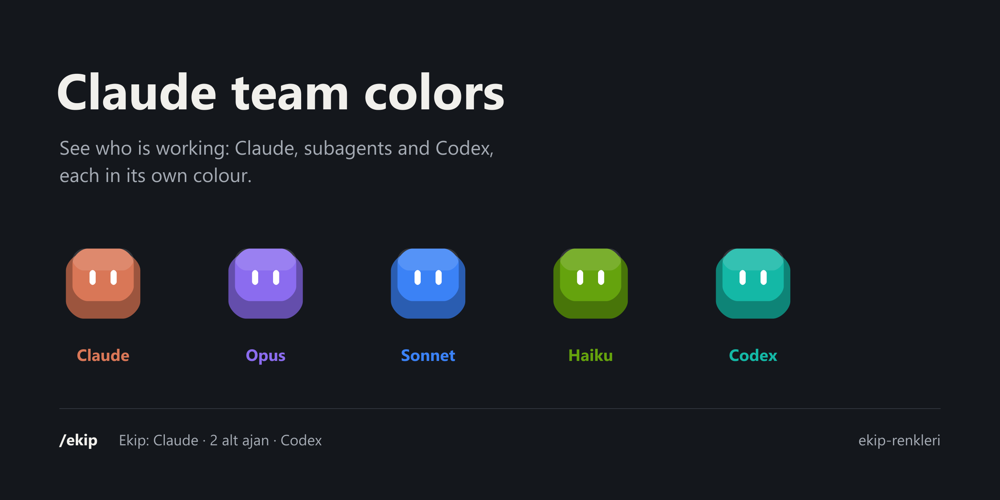
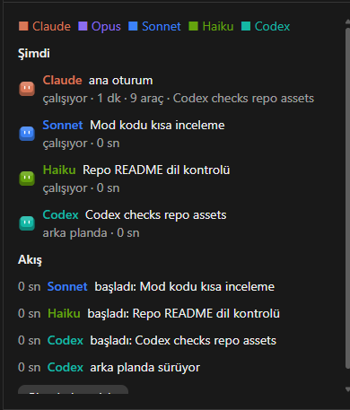
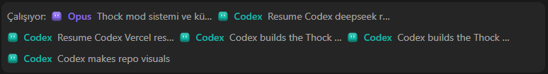
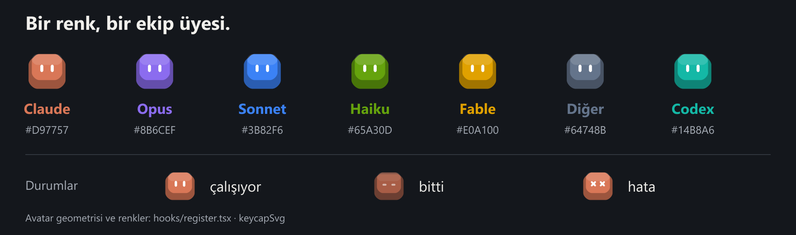

<p align="center">
  
</p>

<h1 align="center">Claude team colors</h1>

<p align="center">
  <b>See who is doing the work in a Claude Code session.</b><br>
  Claude, every subagent and every Codex run gets its own colour and a tiny keycap avatar.
</p>

<p align="center">
  
  
  
</p>

---

When one session runs a main Claude, a few subagents and a Codex job in the background, the transcript turns into a
wall of tool calls. **ekip-renkleri** ("team colours" in Turkish) puts a name, a colour and a face on each worker, so
you can tell at a glance who did what.

## What you get

<table>
  <tr>
    <td width="58%"></td>
    <td>
      <b>Team pane</b> <code>/ekip</code><br><br>
      <b>Now</b>: who is working, for how long, how many tool calls, and what they did last.<br><br>
      <b>Finished</b>: done, stopped or failed, with the time each took.<br><br>
      <b>Feed</b>: every start and finish, coloured by worker.
    </td>
  </tr>
</table>



**Band above the prompt**: the subagents and Codex runs working right now, each as a chip with its avatar.
**Status line**: `Ekip: Claude · 2 alt ajan · Codex` ("team: Claude · 2 subagents · Codex").

## The colours



| Worker | Colour |
| --- | --- |
| Claude, the main session | `#D97757` |
| Subagent on Opus | `#8B6CEF` |
| Subagent on Sonnet | `#3B82F6` |
| Subagent on Haiku | `#65A30D` |
| Subagent on Fable | `#E0A100` |
| Any other subagent | `#64748B` |
| Codex run | `#14B8A6` |

The keycap's eyes show its state: open while working, closed (flat) when done, crossed when it failed.

## Install

At the prompt of a Claude Code terminal session:

```
/plugin install ekip-renkleri --marketplace ArdaYMC/claude-team-colors
```

From a shell:

```bash
claude plugin install ekip-renkleri --marketplace ArdaYMC/claude-team-colors
```

In the Claude desktop app, where `/plugin` does not run: click **+** next to the prompt box, then **Plugins**,
**Add marketplace** with `ArdaYMC/claude-team-colors`, then **Add plugin**.

Needs a Claude Code version that loads mods (2.1.287 or later). Then type `/ekip` to open the pane.

## How it works

- **Subagents** are picked up when they start (`agent.spawn`), coloured by the model they run on, and closed when
  their turn completes.
- **Codex** runs are recognised as Bash calls to `codex.mjs`, `codex.exe` or `codex exec`. A run started in the
  background stays "in the background" until its completion notice reaches the main session.
- **Tool calls** are counted per worker, and the last one is shown beside it.
- A background Codex run is checked every 5 seconds through its output file and closes when the shell writes its exit line; one that never closes is marked unknown after 6 hours.
- Everything stays in the session's own state. Nothing leaves your machine.

The interface text is in Turkish. The pane draws keycap avatars as SVG on the desktop app and as coloured blocks in
the terminal.

## Türkçe

Bir Claude Code oturumunda işi kimin yaptığını renkli, küçük klavye tuşu avatarlarıyla gösterir. Ana oturumdaki
Claude turuncu, alt ajanlar modeline göre (Opus mor, Sonnet mavi, Haiku yeşil, Fable sarı, diğerleri gri), Codex
çalıştırmaları turkuaz görünür. `/ekip` paneli şu an çalışanları, bitenleri ve renkli bir akışı gösterir; komut
satırının üstündeki bant çalışan alt ajan ve Codex işlerini listeler; durum satırı ekibi özetler.

## Licence

MIT. Made by [ArdaYMC](https://github.com/ArdaYMC) with Claude.

<sub>The pane and band images are screenshots from a real Claude Code session.</sub>
